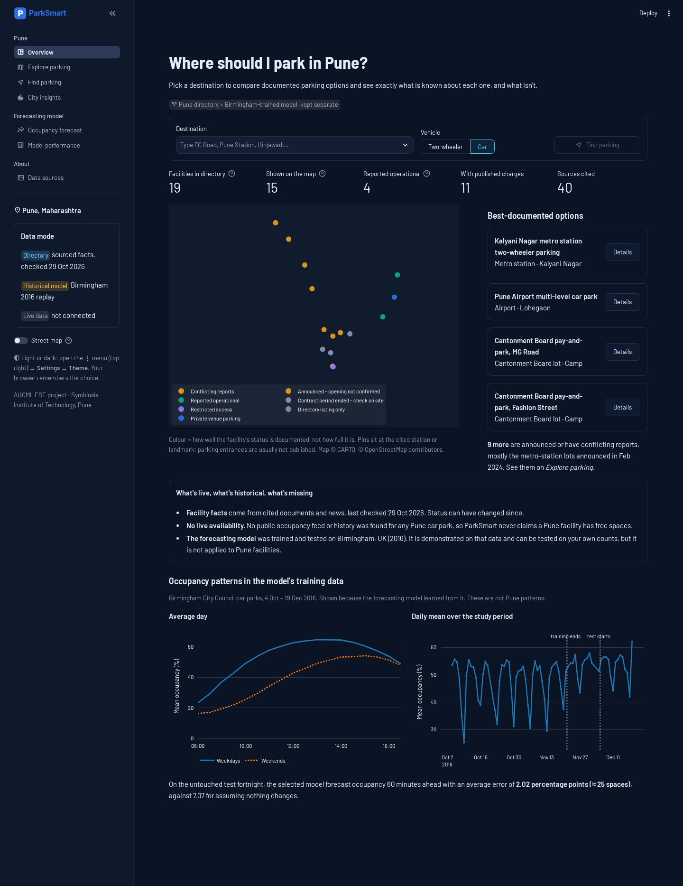

# ParkSmart · Pune

**Pune parking discovery with honest evidence, plus a rigorously evaluated occupancy-forecasting model.**
AUCML (TE7483) end-semester project · B.Tech AIML · Symbiosis Institute of Technology, Pune (2024–28, Sem 5).

> **The question:** *"I'm going to a place in Pune. Where should I consider parking, and what can I reasonably expect when I arrive?"*

ParkSmart answers it with:

* **A sourced Pune parking directory.** It lists 19 facilities. Every fact links to a dated source and carries an evidence label: reported operational, announced, conflicting reports, directory listing, and so on.
* **A transparent Find Parking assistant.** It ranks options for a destination using straight-line distance and how well each facility is documented. It filters by vehicle and budget and prices your stay from published tariffs. It also tells you what is still unknown.
* **An occupancy-forecasting model, trained and tested on public Birmingham (UK) data.** It is kept strictly separate from Pune. It is demonstrated on that data, and a **test-on-your-own-data** tool checks whether it transfers to a new car park before showing any forecast.



## Why the model isn't applied to Pune

The PMC open-data portal, data.gov.in, OpenCity, dataset sites and news were all searched (October 2026). No historical or live occupancy data exists publicly for any Pune car park. Using the Birmingham model on Pune facilities would mean inventing inputs, so ParkSmart never shows a Pune occupancy, availability or forecast. The model's value is demonstrated where it can be measured. The path to Pune is explicit: upload counts, measure error, and use the model only if it beats the "no change" baseline.

## What's verified, historical, predicted, unavailable

| Shown in the app | Kind | Source |
|---|---|---|
| Pune facility names, addresses, operators, published charges, capacities | **Documented**, dated sources checked 29 Oct 2026 | `data/pune/*.json` → `sources.json` (40 sources) |
| Pune facility status | **Evidence label** from those sources | e.g. metro lots "announced Feb 2024, opening not confirmed" |
| Map pins, distances | Cited coordinates of stations and landmarks; **straight-line** distance | Wikipedia, one directory listing |
| Pune occupancy, free spaces, forecasts | **Unavailable** | none public |
| Birmingham occupancy | **Historical** (2016) | UCI *Parking Birmingham*, CC BY 4.0 |
| Forecasts and 90% ranges | **Predicted** by the saved model, replayed | `models/*.joblib` |
| Live data | **Not connected** | — |

## ML results (Birmingham, untouched test fortnight 6–19 Dec 2016)

| 60 min ahead | Test MAE | ≈ spaces |
|---|---|---|
| Persistence (what a live sign shows) | 7.07 pp | 97 |
| Historical profile ("popular times") | 7.24 pp | 102 |
| Persistence + last week's shape (strong rule) | 2.79 pp | 34 |
| Ridge Regression | 2.83 pp | 35 |
| Random Forest | 2.29 pp | 28 |
| **HistGradientBoosting (selected on walk-forward CV)** | **2.02 pp** | **25** |

* 30 min ahead: **1.26 pp** (persistence 3.67 pp).
* Status (LOW/MODERATE/HIGH/FULL, by thresholding the regressor): accuracy **0.932**, macro-F1 **0.915**. Only 2 of 734 FULL cases were called LOW/MODERATE.
* **90% range by time of day** (split-conformal from walk-forward residuals): **89.8%** coverage on test. At 60 min, per-band coverage is 87.6–90.9%, a tighter spread than 86.4–93.0% with a single width.
* **Transfer:** a park-agnostic model on a car park it never saw scored 1.75 pp vs 5.28 pp for persistence. Across 5-fold car-park CV it scored 2.73 pp.

All numbers come from `outputs/metrics/`. The test `test_reported_test_metrics_match_saved_model` recomputes the headline score from the saved model.

## Run it

Needs Python 3.11+. Tested on 3.13 (Linux), and wheels were checked for 3.14 on Windows.

**Windows (Command Prompt)**
```
cd path\to\parksmart
python -m venv .venv
.venv\Scripts\activate
pip install -r requirements.txt
streamlit run app.py
```

**macOS / Linux**
```bash
cd path/to/parksmart
python3 -m venv .venv && source .venv/bin/activate
pip install -r requirements.txt
streamlit run app.py
```

The repository ships with the data, trained models and outputs, so the app opens immediately at http://localhost:8501.

* **Light / dark:** open the ⋮ menu (top right), then **Settings → Theme** (Light, Dark or System). Both palettes are defined in `.streamlit/config.toml` and the browser remembers your choice.
* **No internet?** Turn off **Street map** in the sidebar. Markers, legends and details still work. Fonts are bundled.

## Reproduce everything

```bash
python -m src.data_preprocessing   # Birmingham: audit, clean, 30-min grid
python -m src.eda                  # EDA figures + numbers
python -m src.train                # tuning, walk-forward selection, refit, band intervals (~15 min, 2 cores)
python -m src.evaluate             # test metrics, coverage, importance, unseen-car-park test
python -m src.transfer             # park-agnostic model + held-out check + sample upload file
pytest -q                          # 40 checks: data, leakage, Pune directory, ranking, intervals, transfer, every page
python scripts/build_notebooks.py  # re-execute the notebooks
```
`python -m src.intervals` recomputes only the time-of-day ranges for the saved models. `src.train` already does this.

## App pages

| Page | What it does |
|---|---|
| **Overview** | Destination search, directory metrics, facility map, data-freshness panel, training-data patterns (labelled Birmingham) |
| **Explore parking** | Search and filters (type, vehicle, evidence status, published charges, mapped). Facility detail: address, operator, capacity, tariff table, Google Maps link (directions only to a cited point, otherwise a text search), sources, and an explicit "no occupancy forecast" panel |
| **Find parking** | Destination, vehicle, arrival date/time, stay length, budget, radius → ranked options with score breakdown, cost of the stay, what's still unknown, dated destination notes (e.g. airport 15-min rule), excluded options with reasons |
| **City insights** | Metro-parking announced-vs-reported check, dated policy timeline, PMC 2016 and proposed 2026 rates, what isn't public |
| **Occupancy forecast** | Birmingham replay (forecast vs what happened), through-the-day chart with 90% ranges, **test on your own data** |
| **Model performance** | Interactive comparison, confusion matrices, error by time and car park, interval coverage, importance, generalisation |
| **Data sources** | Provenance table, every source with dates, checking method, limitations |

## Repository layout

```
app.py                      navigation, sidebar (data mode, map mode)
pages/                      overview, explore, find_parking, city_insights, forecast, model_performance, about
src/
  config.py                 paths, thresholds, split dates
  data_loader.py            Pune directory loading + validation (sources, coordinates, statuses, tariffs)
  location_services.py      haversine distance, destination search, Google Maps links
  recommendations.py        transparent scoring, tariff pricing, filters
  data_preprocessing.py     Birmingham audit, cleaning, 30-min grid
  feature_engineering.py    leakage-safe features, chronological split, walk-forward folds
  models.py                 baselines and candidate models
  train.py · evaluate.py    tuning/selection/refit · test metrics and figures
  intervals.py              time-of-day split-conformal ranges
  transfer.py               park-agnostic model + bring-your-own-data check
  predict.py                inference + availability arithmetic
  ui.py · visualizations.py shared Streamlit components and theme-aware Plotly charts
data/pune/                  facilities, destinations, policy, sources (hand-curated JSON) — see data/pune/README.md
data/raw · data/processed   Birmingham CSV and the 30-min grid — see data/README.md
data/samples/               sample upload (a Birmingham car park the transfer model never saw)
models/ · outputs/          saved models · metrics, predictions, figures
notebooks/                  01 data · 02 EDA · 03 training & evaluation · 04 Pune directory & transfer (all executed)
reports/                    report (.md/.docx), presentation script, viva prep, screenshots (light + dark)
docs/                       project design (rubric matrix) and the ParkSmart 2.0 upgrade notes + rubric checklist
static/fonts/               Barlow / Barlow Semi Condensed (SIL OFL) so the app works offline
tests/                      test_pipeline.py (ML) · test_pune.py (directory, ranking, intervals, transfer, pages)
```

## Screenshots

These were captured with the offline map background, because the build machine had no access to map tiles. On a normal connection the maps show CARTO street tiles. Light and dark versions of every page are in `reports/screenshots/`.

| Find parking (light) | Explore → facility detail (dark) |
|---|---|
|  |  |

## Deployment

The app is ready for Streamlit Community Cloud: point it at `app.py`; `requirements.txt` and `.streamlit/config.toml` are picked up automatically. **It has not been deployed yet**, so no public URL is claimed. Deploying needs your Streamlit account.

## Limitations

* The Pune directory is small (19 entries) and status reflects dated sources, not today. The nine metro lots announced in Feb 2024 have no confirmed opening.
* No Pune occupancy data, so Pune forecasts are not available.
* Distances are straight-line. Pins mark stations and landmarks, not parking entrances.
* The model learned from one Birmingham autumn, 08:00–16:30.

## Future scope

Connect an authorised PMC / Pune Metro occupancy feed (the metro lots were announced with occupancy boards) and validate the transfer model on it. Add live routing, verified opening hours and more facilities, events and weather. Deploy to Streamlit Community Cloud.

## Data and licences

* Birmingham data: Stolfi, D. (2017). *Parking Birmingham*. UCI ML Repository. https://doi.org/10.24432/C51K5Z, CC BY 4.0.
* Pune facts: each source is listed in `data/pune/sources.json` and on the Data sources page.
* Map tiles © CARTO, © OpenStreetMap contributors. Fonts: Barlow (SIL OFL 1.1).
