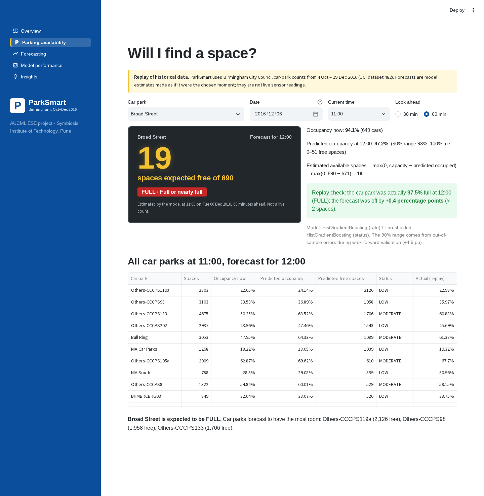

# ParkSmart 🅿️

**ML-based parking occupancy prediction and availability system** — AUCML (TE7483) end-semester project, B.Tech AIML, Symbiosis Institute of Technology, Pune (batch 2024–28, semester 5).

ParkSmart forecasts how full 28 Birmingham car parks will be **30 and 60 minutes ahead**, turns that into **expected free spaces**, and labels the status **LOW / MODERATE / HIGH / FULL**. It is trained and evaluated on the public UCI *Parking Birmingham* dataset (Oct–Dec 2016) and ships with a five-page Streamlit app.

> **Not a live system.** The data ended in December 2016. The app *replays* it: you pick a moment, the model sees only data up to that moment, and the real outcome is shown next to the forecast.



## Headline results (test fortnight 6–19 Dec 2016, never used for any decision)

| 60 min ahead | Test MAE | ≈ spaces | vs persistence |
|---|---|---|---|
| Persistence (what a live sign shows) | 7.07 pp | 97 | — |
| Historical profile ("popular times") | 7.24 pp | 102 | −2% |
| Persistence + last week's shape (strong rule) | 2.79 pp | 34 | +61% |
| Ridge Regression | 2.83 pp | 35 | +60% |
| Random Forest | 2.29 pp | 28 | +68% |
| **HistGradientBoosting (selected)** | **2.02 pp** | **25** | **+71%** |

* 30 min ahead: **1.26 pp** (persistence 3.67 pp).
* Status (thresholded HGB, 60 min): accuracy **0.932**, macro-F1 **0.915**, FULL recall 0.880 / precision 0.932; only 2 of 734 FULL cases called LOW/MODERATE.
* 90% uncertainty range (±4.5 pp, from walk-forward residuals) covered **90.1%** of test outcomes.
* Car parks never seen in training: **2.73 pp**.

All numbers are produced by the code in this repository (`outputs/metrics/`), and a test recomputes the headline score from the saved model.

## Quick start

Requires Python 3.11+ (tested on 3.13). On macOS (Apple Silicon) or Linux:

```bash
git clone https://github.com/palakgoswami454/parksmart.git
cd parksmart
python3 -m venv .venv && source .venv/bin/activate
pip install -r requirements.txt
streamlit run app.py            # opens http://localhost:8501
```

The repository already contains the dataset, the processed grid, the trained models and all outputs, so the app runs immediately.

## Reproduce everything from the raw CSV

```bash
python -m src.data_preprocessing   # clean + 30-min grid      -> data/processed/
python -m src.eda                  # EDA figures + numbers    -> outputs/figures, outputs/metrics/eda_summary.json
python -m src.train                # tune, walk-forward, save -> models/, outputs/predictions/  (~15 min on 2 cores)
python -m src.evaluate             # test metrics + figures   -> outputs/metrics/, outputs/figures/
pytest -q                          # 11 checks (data, leakage, inference, reported = recomputed)
python scripts/build_notebooks.py  # re-execute the three notebooks
```

Single forecast from the command line:

```bash
python -m src.predict --park "Broad Street" --at "2016-12-14 12:00" --horizon 60
```

## How it works

```
raw CSV ─► validate ─► clean ─► 30-min grid ─► leakage-safe features (h = 30 / 60 min)
   ─► chronological split: train 4 Oct–21 Nov │ validation 22 Nov–5 Dec │ test 6–19 Dec
   ─► grid search on validation ─► 4-fold walk-forward selection ─► refit ─► test once
   ─► saved bundle (regressor + status classifier + 90% range) ─► src/predict.py ─► Streamlit app
```

* **Target:** occupancy rate (occupied ÷ capacity) h minutes later, same day; status from thresholds 50 / 75 / 90%.
* **Features (16):** current rate, last two readings, trend, rolling mean/std, time of origin and target, weekday, weekend flag, car-park ID, capacity, rate at the target time yesterday, rates at the origin and target times last week. Only data available at forecast time is used — `tests/test_pipeline.py` corrupts all future values and checks the features do not change.
* **Availability:** `free = max(0, capacity − round(predicted rate × capacity))`.

## Repository layout

```
app.py                      Streamlit app (5 pages)
src/
  config.py                 paths, thresholds, split dates, horizons
  data_preprocessing.py     load, validate, audit, clean, 30-min grid
  eda.py                    EDA figures + summary numbers
  feature_engineering.py    features, target, chronological split, walk-forward folds
  models.py                 baselines + candidate models + tuning grids
  train.py                  tuning, walk-forward selection, refit, save
  evaluate.py               test metrics, figures, importance, unseen-car-park test
  predict.py                inference + availability (CLI and app)
notebooks/                  01 data understanding · 02 preprocessing & EDA · 03 training & evaluation (executed)
data/                       raw CSV (CC BY 4.0) + processed grid — see data/README.md
models/                     parksmart_h30.joblib, parksmart_h60.joblib
outputs/                    metrics (json/csv), predictions, figures
reports/                    report (md + docx), presentation script, viva prep, screenshots
docs/01_project_design.md   rubric matrix, problem refinement, dataset selection, task design
tests/test_pipeline.py      verification suite
scripts/                    notebook builder, screenshot capture
```

## Submission materials

| Rubric component | Where |
|---|---|
| Problem refinement (3) | `docs/01_project_design.md`, report §2–4 |
| Dataset & preprocessing (4) | `data/README.md`, `data/processed/data_quality_report.json`, notebooks 01–02, report §6–9 |
| Methodology & pipeline (5) | report §10–12, `src/models.py` |
| Implementation (5) | `src/`, `app.py`, `tests/`, notebooks |
| Results & comparison (5) | `outputs/`, notebook 03, report §13–14, app *Model performance* |
| Report (3) | `reports/ParkSmart_Report.docx` (and `.md`) |
| Presentation (2) | `reports/presentation_script.md` |
| Viva (3) | `reports/viva_preparation.md` |

## Troubleshooting

* **"Model file not found" in the app** — run `python -m src.train`.
* **Error loading the `.joblib` files** — they were saved with scikit-learn 1.9.1; install the pinned versions from `requirements.txt` or re-run `python -m src.train`.
* **`ModuleNotFoundError: src`** — run commands from the repository root.
* **Port 8501 busy** — `streamlit run app.py --server.port 8502`.
* **A time shows "No reading"** — that car park has a sensor gap at that slot; pick another time.

## Data and citation

Stolfi, D. (2017). *Parking Birmingham* [Dataset]. UCI Machine Learning Repository. https://doi.org/10.24432/C51K5Z — CC BY 4.0.
