**Student:** _(your name, PRN)_ **Faculty:** Dr. Aniket Shahade, Dr. Shrikishna Kolhar, Dr. Sumanto Dutta
**Code and data:** https://github.com/palakgoswami454/parksmart

**Version note.** This report covers ParkSmart 2.0. The ML experiment (Sections 6–14) is unchanged from version 1 except for the time-of-day uncertainty ranges and the transfer model. Section 15 describes the Pune directory and application added in version 2.

# Abstract

Drivers choose a car park based on how full it is now, but they arrive 30–60 minutes later. ParkSmart forecasts, for 28 Birmingham car parks, the occupancy rate 30 and 60 minutes ahead, converts it into expected free spaces using each car park's known capacity, and classifies the expected status as LOW, MODERATE, HIGH or FULL. We use the public UCI *Parking Birmingham* dataset (35,717 readings, 4 Oct – 19 Dec 2016), regularise it onto a 30-minute grid without interpolating missing values, and engineer 16 leakage-safe features (current level, recent trend, time of day, weekday, car-park identity and last week's pattern). Models were tuned on a validation fortnight, selected by four-fold walk-forward validation and reported once on an untouched final fortnight. Three baselines (persistence, historical profile, and a strong "persistence + last week's shape" rule) were compared with Ridge Regression, Random Forest and HistGradientBoosting. HistGradientBoosting was best at both horizons: at 60 minutes its test MAE is 2.02 percentage points (≈ 25 spaces), 71% lower than persistence and 27% lower than the strongest rule; at 30 minutes it is 1.26 pp. Thresholding its forecast gave the best status classifier (60 min: accuracy 0.932, macro-F1 0.915, FULL recall 0.880). Split-conformal 90% ranges with one width per time-of-day band covered 89.8% of test outcomes, with more even coverage across the day than a single width. A park-agnostic version transfers to car parks it never saw (MAE 2.73 pp in car-park cross-validation). Because no public occupancy data exists for Pune, the application (ParkSmart 2.0) pairs the model with a sourced Pune parking directory of 19 facilities and a transparent recommendation assistant. It never attaches a forecast to a Pune facility; instead it offers a test-on-your-own-data tool that shows forecasts only if the model beats persistence on the uploaded counts.

# 1. Introduction and background

Searching for parking adds traffic, emissions and lost time; Shoup (2006) reviewed studies in which a substantial share of traffic in congested central areas was drivers cruising for kerb parking. Off-street car parks reduce this only if drivers know where space will be. Many UK cities publish car-park counts and show them on variable-message signs, but a sign shows the present, not the moment the driver arrives.

Birmingham City Council published such counts; Stolfi, Alba and Yao (2017; 2020) used them to compare polynomial, Fourier, k-means and time-series predictors, and Camero et al. (2019) applied evolutionary deep learning. ParkSmart revisits the problem as a short-horizon tabular forecasting task with a reproducible scikit-learn pipeline, honest baselines and a decision-support interface.

# 2. Refined problem statement

> Given the counts reported by a Birmingham car park up to time *t*, forecast its occupancy rate (and therefore free spaces) at *t* + 30 and *t* + 60 minutes, and classify the expected status, for 28 car parks between 08:00 and 16:30.

The Phase-I idea ("predict parking availability") was refined in four ways: (1) **availability is derived, not detected** — free spaces = max(0, capacity − predicted occupied); (2) **the horizon is fixed by the data** — readings arrive every ~30 min, so 30 and 60 min are supported and shorter ones are not; (3) **prediction is separated from live detection** — the dataset ends in 2016, so the app replays history and never claims to be live; (4) **success is defined against baselines that represent existing practice** — showing the current count (persistence) and a "typical busy times" chart (historical profile).

# 3. Objectives and research questions

**Objectives.** O1 beat persistence and the historical profile on an unseen test period at both horizons; O2 also beat a strong hand-crafted rule; O3 achieve high recall on FULL; O4 provide an uncertainty range with close to nominal coverage; O5 deliver a reproducible app whose numbers come only from saved model outputs.

**Research questions.** RQ1 How much better than naïve and profile baselines can ML forecast occupancy 30 and 60 minutes ahead? RQ2 Which inputs matter most? RQ3 Is it better to classify status directly or to threshold a regression forecast? RQ4 Where are forecasts least reliable, and does the model transfer to unseen car parks?

# 4. Scope and stakeholders

**In scope:** 28 car parks; 08:00–16:30; 4 Oct – 19 Dec 2016; 30- and 60-minute horizons; regression (primary) and status classification; replay application. **Out of scope:** live data feeds, overnight forecasts, events, weather, prices, on-street parking, routing.

| Stakeholder | Decision supported | ParkSmart output |
|---|---|---|
| Drivers, shoppers, commuters | Which car park, when to arrive | Free spaces and status 30/60 min ahead, with alternatives |
| Car-park operators | Staffing, opening overflow, switching FULL signs | Forecast with 90% range; car parks that fill most often |
| City council / traffic management | Reduce queues and cruising; capacity planning | Peak windows; persistently full car parks |
| Navigation and smart-city apps | Integrate forecasts | `src/predict.py` returns a structured forecast |

# 5. Literature review

| Work | Data | Method | Relevance to ParkSmart |
|---|---|---|---|
| Stolfi, Alba & Yao (2017) | Birmingham council car-park data | Polynomial fitting, Fourier series, k-means, time-series; cross-validated, tested on unseen data; web prototype | Same city and data source; long-horizon (up to a day) curve fitting rather than short-horizon tabular ML |
| Stolfi, Alba & Yao (2020) | Birmingham, Glasgow, Norfolk, Nottingham | Same family of predictors; forecasts up to one week | Shows the approach generalises across UK cities |
| Camero et al. (2019) | Car-park occupancy (smart cities) | Deep neural networks whose design is optimised by an evolutionary algorithm | Deep learning is possible, but costly; we test whether tree ensembles suffice |
| Vlahogianni et al. (2016) | Real-time on-street parking sensor data | Short-term occupancy prediction for a real-time parking information service | Motivates short-horizon (minutes-ahead) forecasting as a real-time service |
| Shoup (2006) | Review of cruising studies | — | Motivation: cost of searching for parking |
| Breiman (2001); Friedman (2001) | — | Random forests; gradient boosting | Theoretical basis of our two ensemble models |

**Gap addressed.** Earlier Birmingham work emphasised curve fitting for long horizons. ParkSmart focuses on the 30–60-minute decision window, uses features that are provably available at prediction time, benchmarks against a deliberately strong rule, quantifies uncertainty and evaluates on a held-out future period and on held-out car parks.

# 6. Dataset source, schema and data dictionary

**Source.** *Parking Birmingham*, UCI Machine Learning Repository, ID 482, created by D. Stolfi; DOI 10.24432/C51K5Z; CC BY 4.0; https://archive.ics.uci.edu/dataset/482/parking+birmingham. The UCI page reports 35,717 instances, 4 features, 4 Oct – 19 Dec 2016 and that missing values exist. Because the UCI download host was blocked from our build environment, the CSV was taken from a public GitHub mirror and verified against every one of those facts (automated test `test_raw_matches_uci_description`); its SHA-256 is recorded in `data/README.md`.

| Attribute | Type | Description | Audit |
|---|---|---|---|
| SystemCodeNumber | categorical (string) | Car-park ID | 30 values |
| Capacity | integer | Spaces in the car park | constant per car park, 220–4,675 |
| Occupancy | integer | Occupied spaces (UCI calls it "occupancy rate", but values are counts) | 12 negative; 373 above capacity (max 104.1%) |
| LastUpdated | datetime | Reading timestamp | 07:30–16:34; median gap ≈ 30 min |

**Target variable.** `target_rate` = Occupancy ÷ Capacity at time *t* + *h* (regression), and `target_status` = LOW (< 50%), MODERATE (50–75%), HIGH (75–90%), FULL (≥ 90%) (classification).

**Data quality (raw file).** 0 empty cells; 216 exact duplicate rows; 4 calendar days with no data (20–21 Oct, 3–4 Dec); two sparse car parks (BHMBRTARC01: 88 readings; NIA North: 162).

# 7. Data cleaning and preprocessing

| Step | Reason | Rows affected |
|---|---|---|
| Remove exact duplicates | would double-count readings | 216 removed (35,717 → 35,501) |
| Clip negative occupancy to 0 | a count cannot be negative | 12 |
| Rate = Occupancy ÷ Capacity, capped at 1.0 | a car park cannot be more than full; over-capacity counts reflect queuing/counter drift | 373 capped |
| Drop car parks with < 500 readings | too sparse to provide training days | 2 parks (247 readings) |
| Snap each reading to the nearest 30-min slot if within 10 min; drop others | regular time step so "1 slot ahead" always means 30 min | 292 readings outside 08:00–16:30 or > 10 min from a slot |
| Average readings landing in the same slot | one value per slot | 17 slots |
| Build complete grid: 28 parks × 73 days × 18 slots | makes gaps explicit | 36,792 rows, 1,847 (5.02%) missing |
| **No interpolation** | an invented value could become a training target | — |

Status distribution on the grid: LOW 18,274; MODERATE 9,054; HIGH 4,605; FULL 3,012 slots (FULL ≈ 8.6%).

# 8. Exploratory data analysis

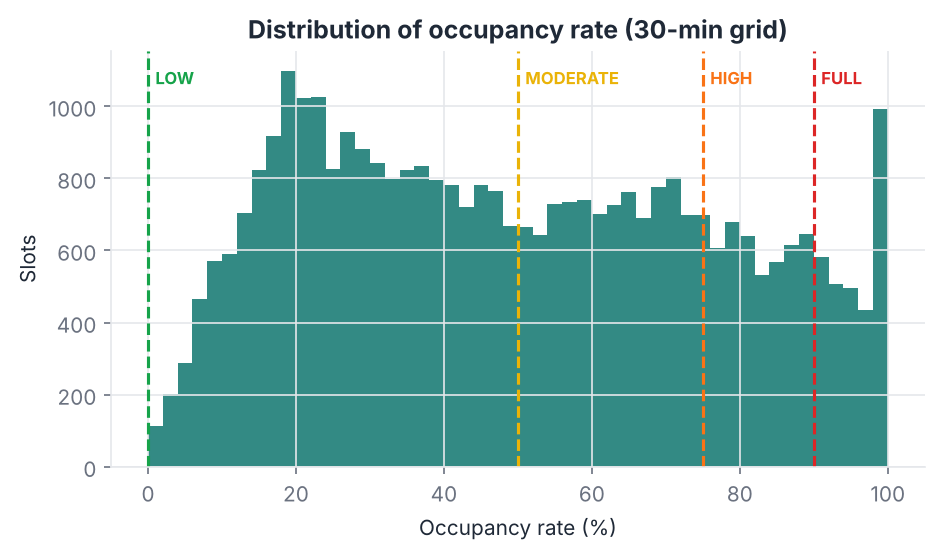

*Figure 1.* The distribution is wide (mean 49.7%, median 47.6% on the cleaned grid) with a spike at 100%. FULL is a minority class, so accuracy alone would hide poor FULL detection; we report macro-F1 and FULL recall.

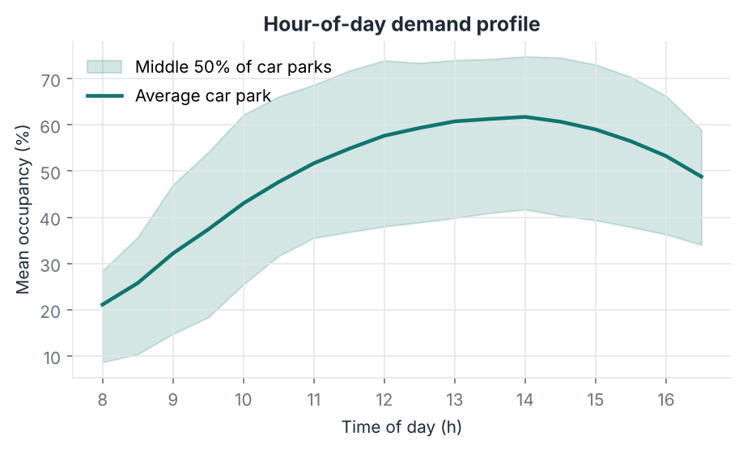

*Figure 2.* Occupancy climbs from 08:00 (quietest) to a peak at 14:00 (61.6% on average) and falls after 15:00. The steep morning climb means persistence will be worst in the morning — confirmed in Section 13.

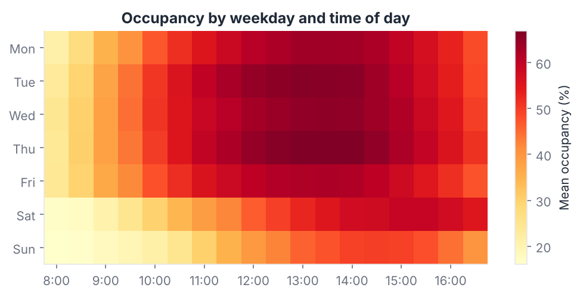

*Figure 3.* Weekday mean 53.4% vs weekend 39.3%; Sunday is lowest (35.6%). This motivates weekday features and "same weekday last week" lags.

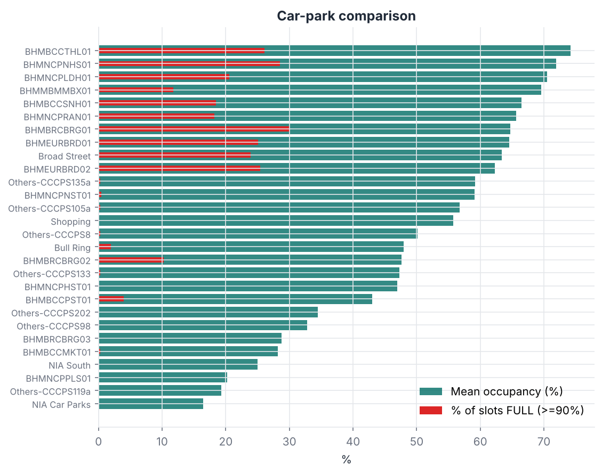

*Figure 4.* Car parks differ greatly: mean occupancy ranges from 16% (NIA Car Parks) to 74% (BHMBCCTHL01). BHMBRCBRG01, BHMNCPNHS01 and BHMBCCTHL01 are FULL in 26–30% of slots; many others never. A car-park identifier is therefore needed.

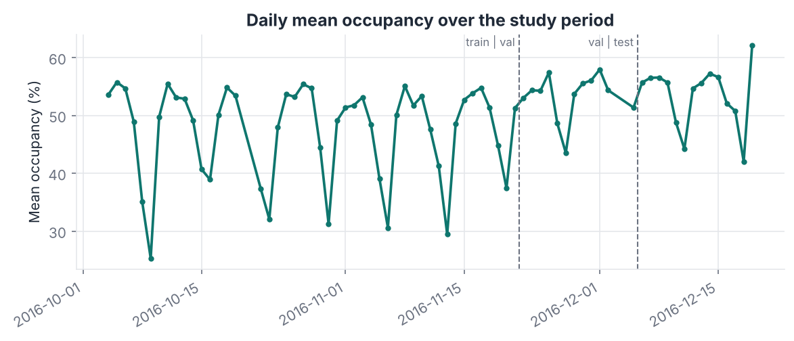

*Figure 5.* A strong weekly cycle and a rise towards Christmas: mean occupancy is 47.6% in training, 53.4% in validation and 53.6% in test; weekend means rise from 36% (October) to 46% (December). A chronological split tests the model under this drift; a random split would hide it.

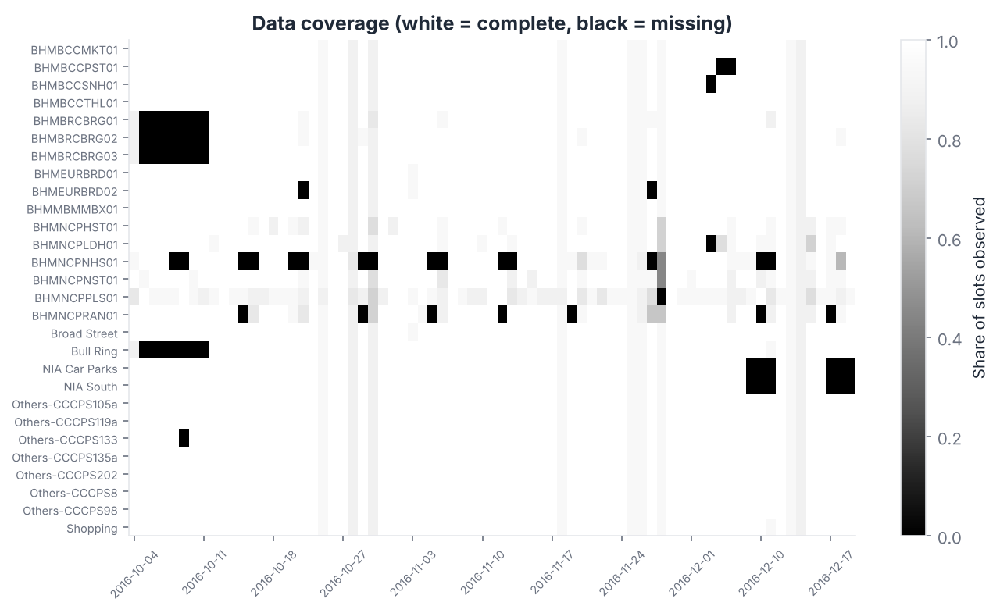

*Figure 6.* Missing data is concentrated (BHMNCPNHS01 23.7% of slots missing, BHMNCPRAN01 13.0%), plus four whole days. Tree models handle missing lag features natively; the linear model uses median imputation with missing-indicator columns.

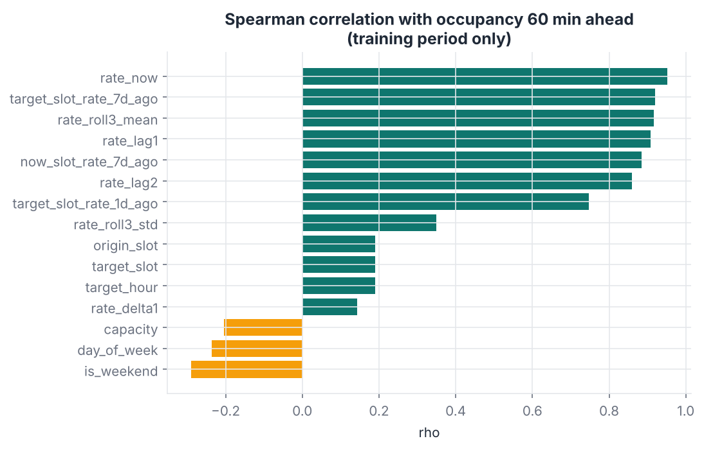

*Figure 7.* On the training period, occupancy 60 min ahead has Spearman ρ = 0.95 with current occupancy and 0.92 with last week's value at the target time. Correlation is association, not causation, and correlated features share information.

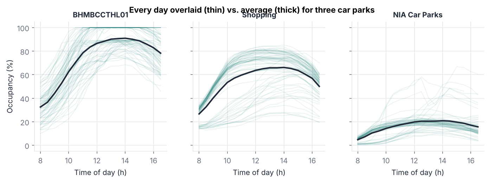

*Figure 8.* Individual days (thin) follow the average shape (thick) closely, but with day-to-day level shifts — exactly the situation where combining "today's level" with "the usual shape" should work.

# 9. Feature engineering

Each row is a forecast origin (car park *p*, slot *t*). Features use only information known at *t*:

| Feature | Description | Why |
|---|---|---|
| park_code | integer ID (categorical) | car parks behave differently (Fig. 4) |
| capacity | total spaces | scale of the car park |
| origin_slot, target_slot, target_hour | time of the origin / of the forecast | diurnal pattern (Fig. 2) |
| day_of_week, is_weekend | calendar | weekly pattern (Fig. 3) |
| rate_now | occupancy rate at *t* | strongest predictor (Fig. 7) |
| rate_lag1, rate_lag2 | rate 30 and 60 min before *t*, same day | recent history |
| rate_delta1 | rate_now − rate_lag1 | short-term trend (filling or emptying) |
| rate_roll3_mean, rate_roll3_std | mean / std of last three slots | smoothed level and volatility |
| target_slot_rate_1d_ago | rate at the target clock time yesterday | daily pattern |
| target_slot_rate_7d_ago, now_slot_rate_7d_ago | rate at the target / origin clock time on the same weekday last week | weekly shape (expected change over the next hour) |

**Leakage controls.** (1) Lags are computed within each day, so 08:00 never uses 16:30 of the previous day as "30 minutes ago". (2) The target is on the same day as the origin. (3) Day-lags look up *earlier* calendar days only. (4) An automated test overwrites every value after a cut-off time with a constant and checks that the features of all earlier origins are byte-for-byte unchanged. (5) A forecast is issued only when the car park has a reading at *t*.

# 10. Methodology and ML pipeline

```
raw CSV ─► validate ─► clean ─► 30-min grid ─► features (h = 30 / 60) ─► chronological split
                                                                            │
          ┌─────────────────────────────────────────────────────────────────┘
          ▼
   TRAIN (4 Oct–21 Nov) ── grid search ──► VALIDATION (22 Nov–5 Dec): best hyper-parameters
          │
   TRAIN+VAL ── 4 expanding weekly walk-forward folds ──► model SELECTION (mean MAE / macro-F1)
          │                                    └──► out-of-fold residuals ──► 90% range
   refit on TRAIN+VAL ──► TEST (6–19 Dec, used once) ──► metrics, error analysis, importance
          │
   save model bundle (joblib) ──► src/predict.py ──► Streamlit app
```

**Split.** Train 4 Oct – 21 Nov 2016 (60-min task: 19,912 rows), validation 22 Nov – 5 Dec (5,080), test 6 – 19 Dec (5,739). The 30-min task has 21,157 / 5,374 / 6,072 rows.

**Walk-forward validation.** Four expanding-window folds whose validation blocks are the weeks 6–12 Nov, 13–19 Nov, 20–26 Nov and 27 Nov – 5 Dec; each fold trains only on earlier dates. Selection uses the mean fold score; the test set never influences any choice.

# 11. Algorithm selection and justification

| Model | Type | Why included | Preprocessing |
|---|---|---|---|
| Persistence | baseline | "nothing changes" = what a live sign shows | none |
| Historical profile | baseline | mean for (car park, weekday, target time) = a "popular times" chart | fitted on training rows only |
| Persistence + weekly shape | strong baseline | rate_now + (last week's rate at target time − last week's rate at origin time); a transparent rule ML must beat | none |
| Ridge Regression | linear ML | interpretable; tests whether a linear combination suffices | one-hot park; median imputation + missing indicators; standard scaling |
| Random Forest | bagged trees (Breiman, 2001) | non-linear interactions, robust | none; native NaN support |
| HistGradientBoosting | boosted trees (Friedman, 2001) | typically strongest on tabular data; native NaN and categorical support; fast | none; park_code declared categorical |
| Majority class, persistence status | classification baselines | lower bounds | none |
| Logistic Regression, RF, HGB classifiers | direct classifiers | `class_weight` tuned for minority FULL/HIGH | as above |
| Thresholded HGB regressor | derived classifier | tests RQ3 | thresholds applied to regression output |

Deep learning was not used: with ~25,000 training rows and short, well-structured inputs, gradient-boosted trees are the appropriate first choice, and the strong results leave little room for a sequence model to justify its cost.

# 12. Experimental setup

| Model | Grid (validation fortnight) | Selected (60 min) | Selected (30 min) |
|---|---|---|---|
| Ridge | α ∈ {0.1, 1, 10, 100} | α = 0.1 | α = 0.1 |
| Random Forest (200 trees) | max_depth {10, 20, None} × min_samples_leaf {1, 5, 20} × max_features {0.5, 1.0} | None, 1, 1.0 | 20, 1, 0.5 |
| HistGradientBoosting | learning_rate {0.03, 0.1} × max_iter {300, 600} × max_leaf_nodes {15, 31, 63} × l2 {0, 1} | 0.03, 600, 63, 0 | 0.03, 600, 63, 1.0 |
| Logistic Regression | C {0.1, 1, 10} × class_weight {None, balanced} | 1.0, balanced | 1.0, balanced |
| RF classifier | depth {10, 20, None} × leaf {1, 5} × class_weight | 20, 1, balanced | 20, 5, balanced |
| HGB classifier | lr {0.03, 0.1} × leaves {15, 31} × class_weight | 0.1, 31, balanced | 0.03, 15, balanced |

Random seed 42 throughout. Metrics: MAE, RMSE, R² and MAE in spaces (regression); accuracy, macro and weighted precision/recall/F1, per-class FULL and HIGH precision/recall, confusion matrix (classification). ROC-AUC was not used: the task is four-class ordinal and our decisions rely on hard labels and on the regression output, so a one-vs-rest AUC would add little. Environment: Python 3.13, scikit-learn 1.9.1, 2 CPU cores.

# 13. Results and model comparison

**Table 1. Regression, 60 minutes ahead (test 6–19 Dec 2016).**

| Model | Test MAE (pp) | Test RMSE (pp) | R² | MAE (spaces) | vs persistence | Walk-forward MAE (pp, mean ± sd) |
|---|---|---|---|---|---|---|
| Persistence | 7.07 | 10.06 | 0.852 | 97.3 | — | 6.90 ± 0.42 |
| Historical profile | 7.24 | 9.99 | 0.854 | 101.7 | −2.3% | 6.50 ± 1.14 |
| Persistence + weekly shape | 2.79 | 4.85 | 0.966 | 34.4 | +60.6% | 2.26 ± 0.24 |
| Ridge Regression | 2.83 | 4.16 | 0.975 | 35.3 | +60.0% | 2.64 ± 0.15 |
| Random Forest | 2.29 | 3.45 | 0.983 | 27.9 | +67.7% | 2.24 ± 0.12 |
| **HistGradientBoosting** | **2.02** | **3.00** | **0.987** | **24.7** | **+71.4%** | **2.06 ± 0.19** |

**Table 2. Regression, 30 minutes ahead.**

| Model | Test MAE (pp) | Test RMSE (pp) | R² | MAE (spaces) | Walk-forward MAE (pp) |
|---|---|---|---|---|---|
| Persistence | 3.67 | 5.25 | 0.961 | 49.9 | 3.61 |
| Historical profile | 7.10 | 9.88 | 0.862 | 99.6 | 6.38 |
| Persistence + weekly shape | 1.71 | 2.79 | 0.989 | 20.7 | 1.50 |
| Ridge Regression | 1.62 | 2.36 | 0.992 | 20.0 | 1.61 |
| Random Forest | 1.37 | 2.00 | 0.994 | 16.7 | 1.39 |
| **HistGradientBoosting** | **1.26** | **1.83** | **0.995** | **15.3** | **1.29** |

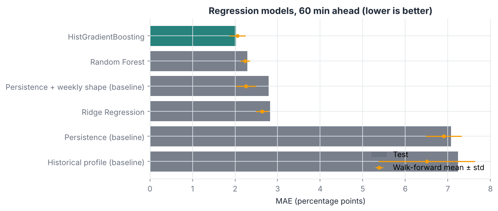

*Figure 9.* Test MAE (bars) and walk-forward mean ± sd (points). The walk-forward ranking of the four strongest methods (HGB < RF < weekly-shape rule < Ridge) is the same on test; only the two weak baselines swap places. Validation-based selection therefore picked the model that is also best on unseen data.

**Table 3. Status classification, 60 minutes ahead (test).**

| Model | Accuracy | Macro P | Macro R | Macro F1 | Weighted F1 | FULL P | FULL R | HIGH R |
|---|---|---|---|---|---|---|---|---|
| Majority class | 0.408 | 0.102 | 0.250 | 0.145 | 0.236 | 0.000 | 0.000 | 0.000 |
| Persistence | 0.770 | 0.738 | 0.719 | 0.725 | 0.761 | 0.778 | 0.741 | 0.526 |
| Logistic Regression | 0.904 | 0.881 | 0.889 | 0.885 | 0.904 | 0.879 | 0.898 | 0.825 |
| Random Forest | 0.917 | 0.900 | 0.899 | 0.899 | 0.918 | 0.917 | 0.872 | 0.855 |
| HGB classifier | 0.916 | 0.898 | 0.895 | 0.896 | 0.916 | 0.906 | 0.884 | 0.822 |
| **Thresholded HGB regressor** | **0.932** | **0.919** | **0.912** | **0.915** | **0.931** | **0.932** | 0.880 | **0.863** |

At 30 minutes the thresholded regressor again had the best macro-F1 (0.940; accuracy 0.954; FULL recall 0.914, FULL precision 0.946).

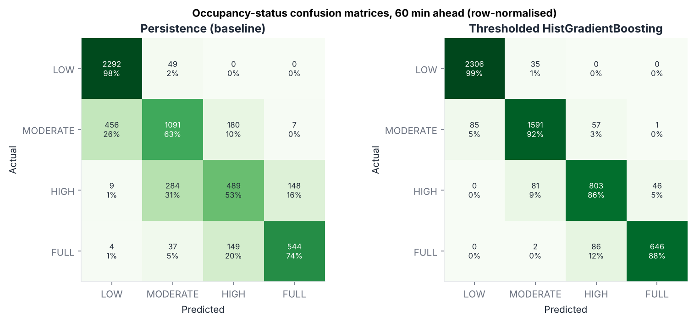

*Figure 10.* Persistence confuses neighbouring classes heavily (only 53% of HIGH correct). The selected model gets 99% of LOW, 92% MODERATE, 86% HIGH and 88% FULL right, and almost all errors are between *adjacent* classes.

**Answers to the research questions.**
*RQ1:* ML reduces 60-min error by 71% versus persistence and 27% versus the strongest rule (30 min: 66% and 26%).
*RQ2:* see Section 14.
*RQ3:* thresholding the regressor beats every direct classifier on macro-F1 at both horizons — the continuous forecast carries more information than four labels, and one model serves both outputs. Logistic Regression has the highest FULL recall (0.898) at the cost of lower precision; we prefer the thresholded model's balance (FULL P 0.932 / R 0.880) because it misses almost no FULL periods badly (next paragraph).
*RQ4:* see Section 14.

**Cost-sensitive view.** Of 734 test cases that were really FULL 60 minutes later, the selected classifier labelled 646 FULL, 86 HIGH and only 2 MODERATE/LOW. Missing a FULL car park sends a driver into a queue; a false FULL warning (47 cases) merely suggests an alternative. Predicting HIGH for a FULL car park is a much milder error than predicting LOW.

**Uncertainty.** The 90% range is split-conformal: ± a quantile of absolute out-of-fold walk-forward residuals, each from a model trained only on earlier weeks. A single width (±4.50 pp at 60 min, ±2.87 pp at 30 min) covered 90.1% and 90.2% of test outcomes overall, but unevenly: 86.4% for 11:00–12:30 targets and 93.0% for 13:00–14:30 (60 min). ParkSmart therefore uses one width per time-of-day band ("Mondrian" conformal). At 60 min the bands are ±5.19 pp (08:30–10:30), ±4.72 (11:00–12:30), ±3.99 (13:00–14:30) and ±4.13 (15:00–16:30). Test coverage is 89.8% overall and 87.6–90.9% per band; at 30 min it is 90.2% overall and 89.1–91.2% per band.

| Target-time band (60 min) | Half-width | Coverage, one width | Coverage, by band |
|---|---|---|---|
| 08:30–10:30 | ±5.19 pp | 88.1% | 90.9% |
| 11:00–12:30 | ±4.72 pp | 86.4% | 87.6% |
| 13:00–14:30 | ±3.99 pp | 93.0% | 90.0% |
| 15:00–16:30 | ±4.13 pp | 92.6% | 90.5% |

**Efficiency.** Final HistGradientBoosting fit ≈ 4 s; prediction ≈ 21 ms per 1,000 rows (60 min), i.e. well under a millisecond per car park. Random Forest took ≈ 21 s to fit and predicts about twice as slowly.

# 14. Error analysis and interpretation

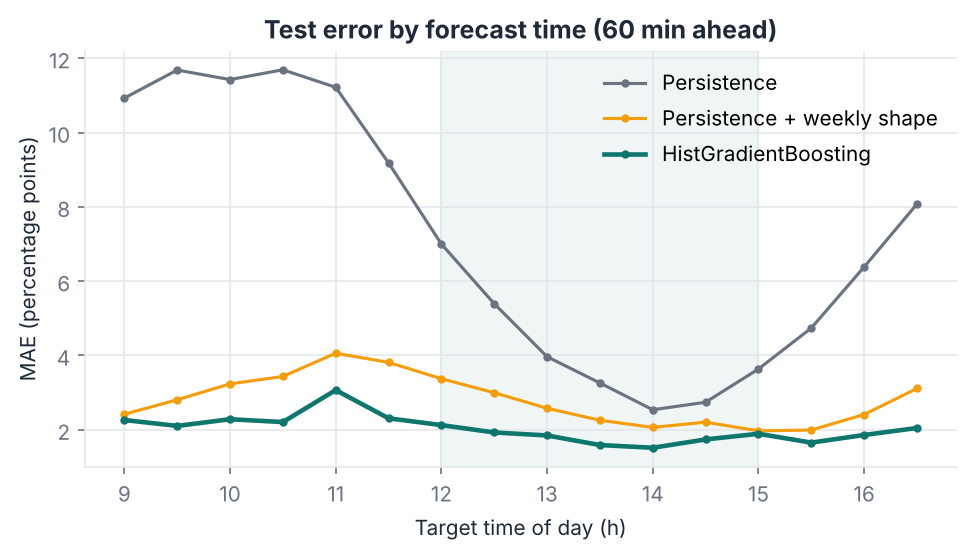

*Figure 11.* Error by target time. Persistence is worst during the morning fill-up and late-afternoon emptying. The selected model's hardest times are 10:00–11:30; error in the 12:00–15:00 peak (1.80 pp) is *lower* than off-peak (2.19 pp) because occupancy changes slowly near the peak. Weekends (2.50 pp) are harder than weekdays (1.84 pp) — fewer weekend examples and stronger pre-Christmas change.

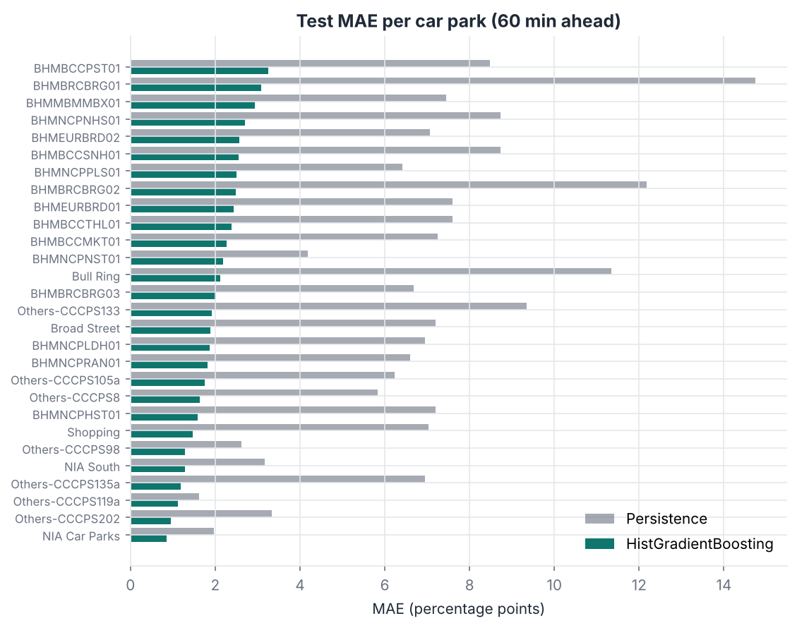

*Figure 12.* Every car park improves over persistence. Errors range from 0.86 pp (NIA Car Parks) to 3.25 pp (BHMBCCPST01). The hardest car parks (BHMBCCPST01, BHMBRCBRG01, BHMMBMMBX01) are small or often full and change quickly; in spaces the largest error is Others-CCCPS133 (90 spaces) simply because it has 4,675 spaces.

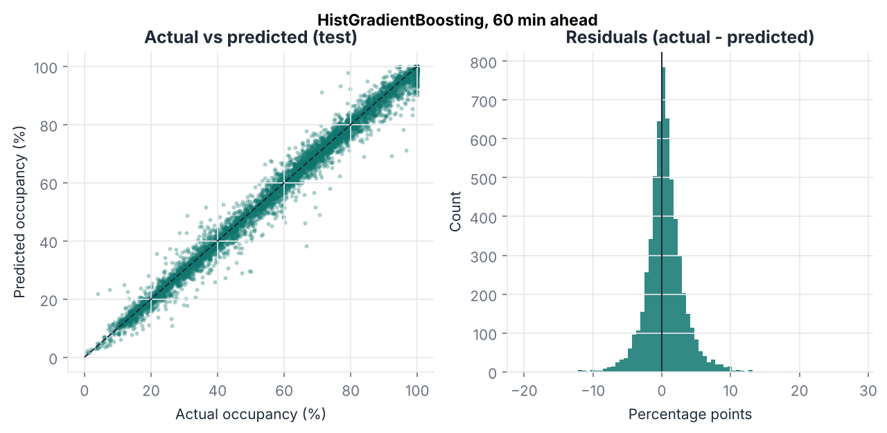

*Figure 13.* Predictions lie close to the diagonal; residuals are centred near zero (mean +0.47 pp, i.e. a slight under-prediction in the busier test period) and 95% are within ±5.97 pp.

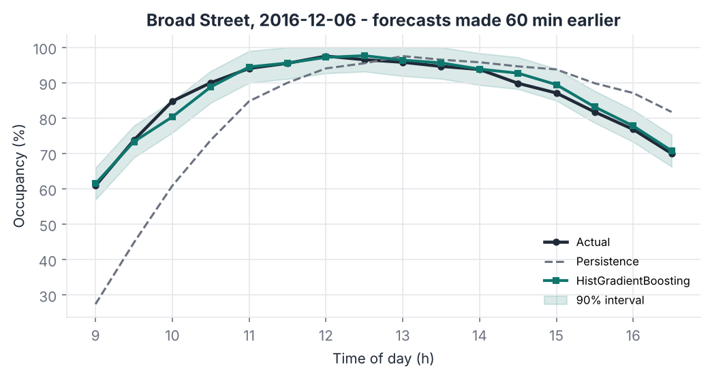

*Figure 14.* Broad Street on 6 Dec: persistence lags the morning rise by an hour; the model anticipates it and stays inside its 90% range almost all day.

**Representative predictions (60 min, test).**

| Error percentile | Car park | Forecast made → for | Now | Actual | Predicted | Error (pp) | Status actual / predicted |
|---|---|---|---|---|---|---|---|
| 10th | BHMBCCTHL01 | 13 Dec 09:00 → 10:00 | 63.3% | 81.7% | 81.9% | −0.22 | HIGH / HIGH |
| 50th | BHMEURBRD01 | 14 Dec 12:00 → 13:00 | 93.2% | 94.0% | 95.4% | −1.38 | FULL / FULL |
| 90th | Others-CCCPS105a | 15 Dec 12:00 → 13:00 | 70.5% | 77.2% | 72.7% | +4.48 | HIGH / MODERATE |
| 99th | BHMBCCSNH01 | 11 Dec (Sun) 10:30 → 11:30 | 43.0% | 65.9% | 55.8% | +10.10 | MODERATE / MODERATE |

The 99th-percentile error is a pre-Christmas Sunday-morning surge: occupancy rose 23 points in the hour while the model expected 13. Shopping-season or event-driven surges are exactly what the available features cannot see.

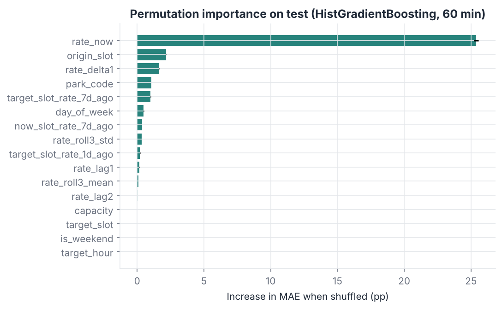

*Figure 15.* Permutation importance (increase in test MAE when a feature is shuffled). `rate_now` dominates (+25.4 pp), followed by `origin_slot` (+2.16), `rate_delta1` (+1.63), `park_code` (+1.07) and `target_slot_rate_7d_ago` (+1.01). `target_slot` and `target_hour` show ≈ 0 only because `origin_slot` carries the same information (target = origin + 2) — shuffling one of a set of correlated features underestimates it. Importance describes what the model relies on, not what causes demand.

**Generalisation to unseen car parks.** In a 5-fold GroupKFold over car parks, with the car-park ID removed, models trained on the other car parks reached a test MAE of **2.73 pp** on the held-out ones, versus 2.02 pp for known car parks and 7.07 pp for persistence. The model therefore learns transferable dynamics.

**Transfer model.** `src/transfer.py` trains this park-agnostic model on 27 car parks and keeps one (Others-CCCPS8) out entirely. On that car park it scores 1.75 pp at 60 min (persistence 5.28 pp) and 1.10 pp at 30 min (persistence 2.69 pp); its range comes from car-park-level cross-validation and covered 97.7% (conservative). The held-out car park shares the city and period of the training data, so this is easier than a new city would be. It justifies *testing* the model on Pune counts, not using it unchecked.

# 15. ParkSmart 2.0: Pune focus and application

## 15.1 Pune data: what exists

The application is meant for Pune. A search in October 2026 covered the PMC open-data portal, data.gov.in, OpenCity, dataset sites and news. It found **no public historical or live occupancy data for any Pune car park**. (The data.gov.in catalog "Parking lots: Pune" exists but blocks automated access.) A Pune occupancy model therefore cannot be trained or validated. Applying the Birmingham model to Pune facilities would require inventing its inputs (the current count, recent lags, last week's values), so ParkSmart does not do it.

What *can* be documented was collected into `data/pune/` (19 facilities, 16 destinations, 11 dated policy items, 40 sources):

* **Metro-station parking.** Pune Metro announced lots at nine stations on 15 Feb 2024, with rates of ₹15/30/60 for two-wheelers and ₹35/50/80 for cars for up to 2 h / 2–6 h / over 6 h. No confirmation of opening was found. A Dec 2024 report says most stations lack parking and Swargate users park on the street. A Sep 2025 report says no parking will be provided in the PCMC area. These lots are labelled *announced* or *conflicting*.
* **Pune station.** The Central Railway register (15 Jul 2025) lists three pay-and-park sites with areas and contract dates, all of which ended by Dec 2025 (*contract period ended*).
* **Airport.** Multi-level car park for 1,000 cars and 1,000 two-wheelers, reported opening Oct 2022. A 15-minute terminal-area limit has applied since Jun 2026.
* **Camp.** Pune Cantonment Board lots at MG Road and Fashion Street with rates confirmed by the Board's CEO (Jul 2026).
* **Municipal.** Two lots known only from third-party directories, and one non-operational multi-level structure.
* **Policy.** PMC Public Parking Policy 2016 (zone-based rates), Mar 2026 on-street pilot tender (FC Road, JM Road, Laxmi Road, Viman Nagar, Balewadi High Street, Bibvewadi) and the Sep 2026 proposed zone rates.

Every fact cites a dated source. Coordinates come from the cited station, landmark or listing. Wikipedia locality coordinates for Kothrud, Aundh and Pune Camp were several kilometres wrong when checked against nearby stations, so they were rejected. `src/data_loader.py` refuses to load the directory if a fact lacks a source, a coordinate falls outside Pune, or a status or tariff is malformed.

## 15.2 Decision support

*Find parking* ranks facilities for a destination by **score = 0.6 × proximity + 0.4 × evidence**. Proximity is 1 − straight-line distance ÷ radius. Evidence is 0.90 for reported operational, 0.70 for private venue, 0.50 for contract ended, 0.40 for announced, 0.35 for directory listing and 0.20 for conflicting. A facility is excluded only for a known reason: non-operational or restricted, a vehicle type its sources don't list, a published price over the budget, or distance beyond the radius. Unknown price, capacity or hours are reported under *still unknown*, never treated as zero or as a pass. The cost of the stay is computed from the published band tariffs. Distances are straight-line and labelled as such; no routing service is used.

## 15.3 Bringing the model to Pune with evidence

The *Test on your own data* tool accepts occupancy counts in a simple CSV (facility, capacity, occupied, timestamp). It cleans and grids them with the same code as the Birmingham pipeline and runs the park-agnostic model. It reports the model's error against persistence on those counts and shows forecasts **only if the model wins**. This is the route by which a Pune operator's data could justify Pune forecasts.

## 15.4 Architecture

```
data/pune/*.json ─► src/data_loader.py (validate) ─► src/location_services.py, src/recommendations.py ─┐
data/raw/dataset.csv ─► src/data_preprocessing.py ─► src/feature_engineering.py ─► src/train.py ─────┤
        src/intervals.py (time-band ranges) · src/evaluate.py · src/transfer.py · src/predict.py ────────┤
                                                                     src/ui.py, src/visualizations.py ┘
                                                                     app.py + pages/ (7 pages)
```

Pages: Overview, Explore parking, Find parking, City insights (Pune); Occupancy forecast, Model performance (Birmingham-trained model, labelled "This is not Pune data"); Data sources. The UI never trains or hard-codes results. Light and dark palettes are defined in Streamlit's theme configuration; charts are theme-aware Plotly; fonts are bundled, and an offline map mode keeps the app usable without internet. The app was tested with 40 automated checks, including every page and the Find parking form end-to-end.

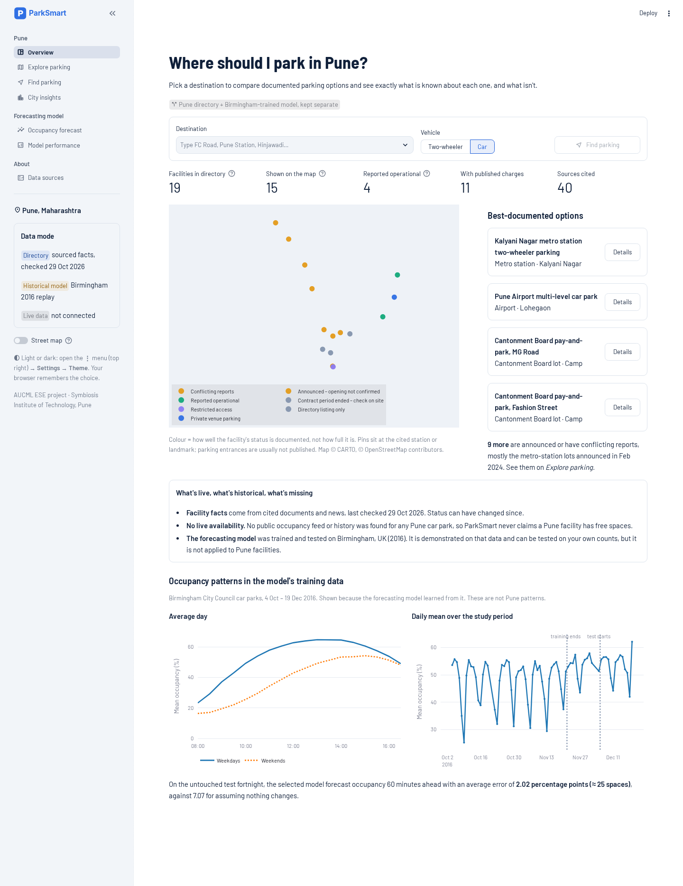

*Figure 16.* Overview: destination search, directory metrics, facility map coloured by evidence (not by occupancy), and the "what's live, historical, missing" panel. The screenshots use the offline map background because the build machine could not load map tiles.

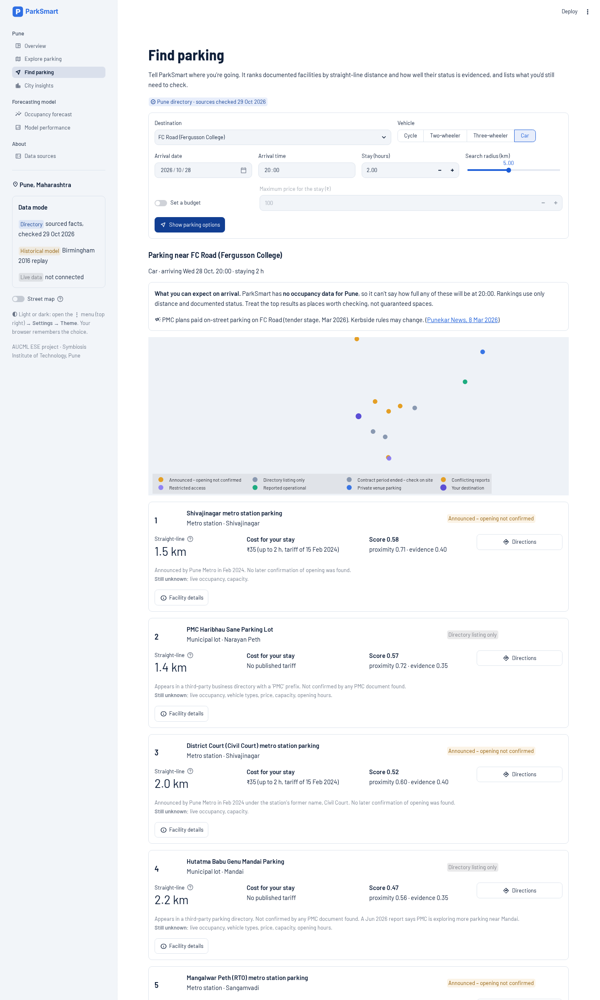

*Figure 17.* Find parking for FC Road by car, 2 h. Options are ranked with their score breakdown and stay cost; the dated note about the planned FC Road pay-and-park pilot is shown, and the page states that no Pune occupancy data exists.

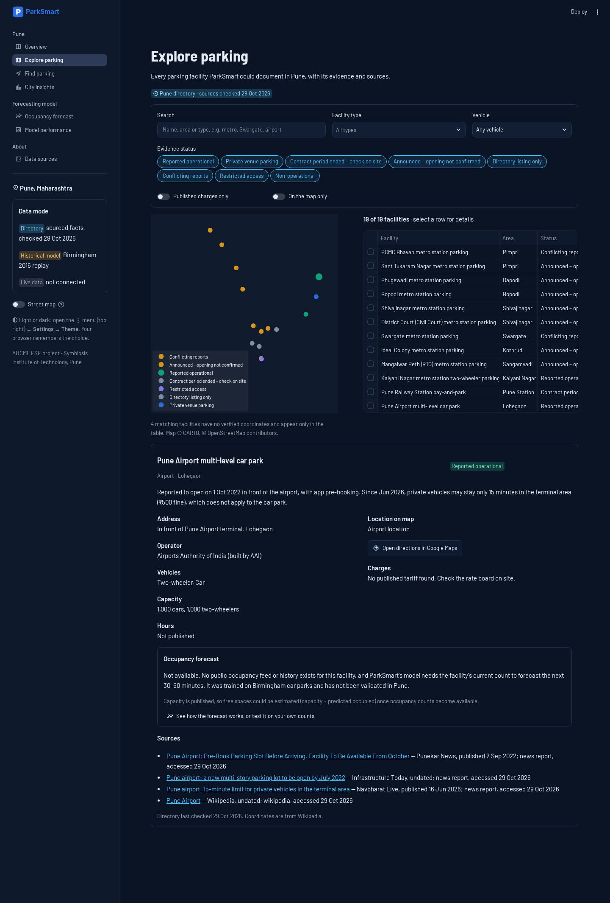

*Figure 18.* Explore parking (dark mode): filters, map and the airport car park's detail card with capacity, sources, and an explicit "occupancy forecast: not available" panel.

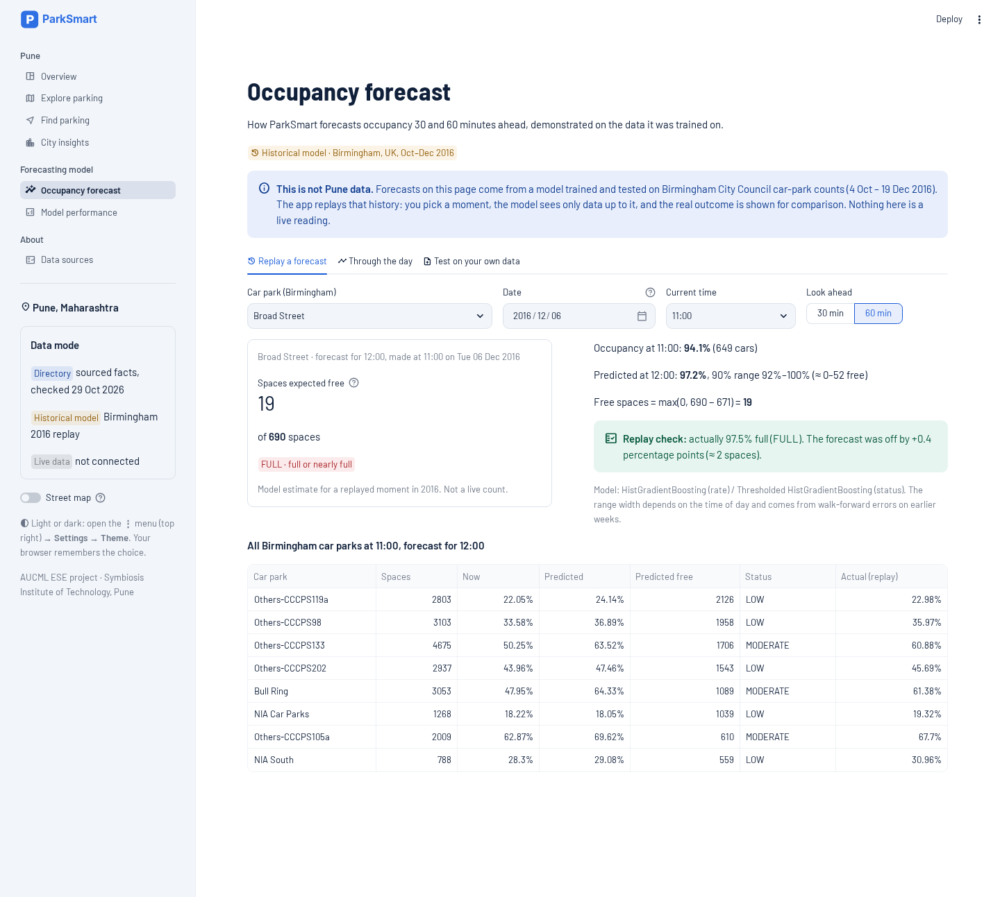

*Figure 19.* Occupancy forecast (Birmingham replay): 19 of 690 spaces expected free at Broad Street at 12:00 on 6 Dec 2016; the actual occupancy was 97.5% (forecast error +0.4 pp).

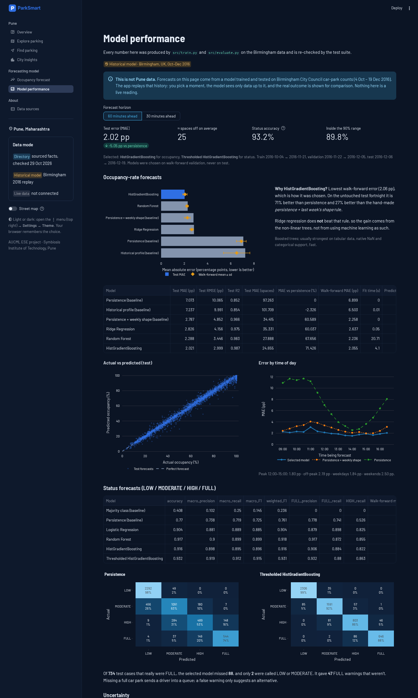

*Figure 20.* Model performance (dark mode), built from the saved evaluation outputs.

# 16. Practical use cases and decision support

* **Pune drivers (2.0):** choose a destination, see documented options ranked by distance and evidence, the price of the stay where tariffs are published, and what to check on arrival. ParkSmart does not promise a free space.
* **Pune operators and PMC:** the transfer tool shows what an occupancy feed would unlock; the City insights page shows the gap between announced and confirmed metro parking.
* **Drivers (Birmingham replay):** demand peaks at 14:00 and is within three points of the peak from 12:30 to 15:00; arriving before 12:30 or choosing a car park forecast LOW/MODERATE avoids queues. Car parks with the most room on average: NIA Car Parks, Others-CCCPS119a, BHMNCPPLS01, NIA South.
* **Operators:** a 60-minute forecast accurate to ≈ 25 spaces on average is enough to switch FULL signs or open overflow decks before queues form; the 90% range tells them how much margin to keep. Car parks that are FULL in 26–30% of slots (BHMBRCBRG01, BHMNCPNHS01, BHMBCCTHL01) are candidates for pricing or capacity measures.
* **City:** network-wide forecasts allow guidance signs to direct drivers to car parks that will have space, not just ones that have space now.

# 17. Limitations and ethical considerations

* **Not live.** The data ended in December 2016; the prototype replays it. Deployment would need a live feed and re-training.
* **Short history.** 73 days in one autumn; no summer, school holidays or major events. The test fortnight includes pre-Christmas drift, which is realistic but also means results may not hold in other seasons.
* **Missing context.** No events, weather, prices or roadworks; sudden surges (Section 14, 99th-percentile example) cannot be anticipated.
* **Sensor dependence.** A forecast needs a current reading; 5% of slots are missing and some car parks drop out for days.
* **Operating hours.** Only 08:00–16:30 is covered.
* **Pune coverage.** No Pune occupancy data; the directory is small and dated, and metro-lot status is uncertain. Pune forecasts are deliberately not shown.
* **Ethics.** The data are aggregate counts with no personal information. Risks are mainly of over-reliance: a wrong "space available" message could send many drivers to the same car park. ParkSmart mitigates this by labelling every number as an estimate, showing an uncertainty range and never presenting forecasts as live counts. If deployed, forecast-driven redirection should be monitored for feedback effects.

# 18. Conclusion

ParkSmart shows that short-horizon car-park occupancy can be forecast accurately from a small public dataset with careful, leakage-free feature engineering and standard tabular ML. HistGradientBoosting reduced 60-minute error from 7.07 pp (persistence) to 2.02 pp (≈ 25 spaces), beat a strong hand-crafted rule by 27%, produced the best status classification by thresholding, and came with a calibrated 90% range. Comparing against that strong rule was important: a linear model did not beat it, so the gains come from learning non-linear interactions rather than from ML per se. ParkSmart 2.0 takes this to Pune honestly: a sourced directory and transparent assistant for the decisions that can be supported today, and a measured path (the transfer check) for adding forecasts once Pune occupancy data exists. The application is explicit about what is documented, predicted, historical and unavailable.

# 19. Future scope

1. Connect a live open-data feed and re-train on a full year, including holidays and events.
2. Add event calendars, weather and retail-season indicators to capture surges.
3. Conformalised quantile regression for ranges that adapt to each forecast, beyond the time-of-day bands now used.
4. Multi-horizon and full-day forecasts (recursive or direct strategies).
5. Compare with sequence models (LSTM/Temporal Fusion Transformer) once more data is available, as in Camero et al. (2019).
6. Obtain Pune occupancy counts (PMC, Pune Metro occupancy boards, or the data.gov.in 'Parking lots: Pune' catalog) and validate the transfer model on them; extend the directory with verified PMC lots.
7. Route-aware recommendations combining forecasts with travel time.

# 20. References

1. Stolfi, D. (2017). *Parking Birmingham* [Dataset]. UCI Machine Learning Repository. https://doi.org/10.24432/C51K5Z
2. Stolfi, D. H., Alba, E., & Yao, X. (2017). Predicting car park occupancy rates in smart cities. In E. Alba, F. Chicano & G. Luque (Eds.), *Smart Cities (Smart-CT 2017)*, Lecture Notes in Computer Science, vol. 10268. Springer, Cham. https://doi.org/10.1007/978-3-319-59513-9_11
3. Stolfi, D. H., Alba, E., & Yao, X. (2020). Can I park in the city center? Predicting car park occupancy rates in smart cities. *Journal of Urban Technology, 27*(4), 27–41. https://doi.org/10.1080/10630732.2019.1586223
4. Camero, A., Toutouh, J., Stolfi, D. H., & Alba, E. (2019). Evolutionary deep learning for car park occupancy prediction in smart cities. In *Learning and Intelligent Optimization (LION 12)*, Lecture Notes in Computer Science, vol. 11353, 386–401. https://doi.org/10.1007/978-3-030-05348-2_32
5. Vlahogianni, E. I., Kepaptsoglou, K., Tsetsos, V., & Karlaftis, M. G. (2016). A real-time parking prediction system for smart cities. *Journal of Intelligent Transportation Systems, 20*(2), 192–204. https://doi.org/10.1080/15472450.2015.1037955
6. Shoup, D. C. (2006). Cruising for parking. *Transport Policy, 13*(6), 479–486. https://doi.org/10.1016/j.tranpol.2006.05.005
7. Breiman, L. (2001). Random forests. *Machine Learning, 45*(1), 5–32. https://doi.org/10.1023/A:1010933404324
8. Friedman, J. H. (2001). Greedy function approximation: A gradient boosting machine. *The Annals of Statistics, 29*(5), 1189–1232. https://doi.org/10.1214/aos/1013203451
9. Pedregosa, F., et al. (2011). Scikit-learn: Machine learning in Python. *Journal of Machine Learning Research, 12*, 2825–2830.
10. Hyndman, R. J., & Athanasopoulos, G. (2021). *Forecasting: Principles and Practice* (3rd ed.). OTexts. https://otexts.com/fpp3/ (time-series cross-validation)
11. Pune parking sources (Pune Metro release via Republic World and Punekar News, 15 Feb 2024; Punekar News 17 Dec 2024, 8 Mar 2026, 30 Jul 2026, 22 Sep 2026; Free Press Journal 27 Sep 2025, 12 Jun 2026; Central Railway Pune Division Pay & Park register 15 Jul 2025; PMC Public Parking Policy 2016; Navbharat Live 16 Jun 2026), all listed with links in `data/pune/sources.json`.

# Appendix A. Reproducing every result

```bash
git clone https://github.com/palakgoswami454/parksmart.git && cd parksmart
python3 -m venv .venv && source .venv/bin/activate
pip install -r requirements.txt
python -m src.data_preprocessing   # 30-min grid + data_quality_report.json
python -m src.eda                  # EDA figures + eda_summary.json
python -m src.train                # ~15 min on 2 cores: tuning, walk-forward, saved models
python -m src.evaluate             # test metrics, figures, importance, unseen-park test, band coverage
python -m src.transfer             # park-agnostic model, held-out check, sample upload file
pytest -q                          # 40 checks incl. leakage, "reported = recomputed", Pune directory, pages
streamlit run app.py
```

# Appendix B. Key implementation details

* **Target construction** (`src/feature_engineering.py`): `target_rate = groupby([park, date]).occupancy_rate.shift(-h)`; rows whose target slot is beyond 16:30 or unobserved are dropped for training.
* **Weekly-shape baseline** (`src/models.py`): `rate_now + (rate_7d_ago[target] − rate_7d_ago[origin])`, falling back to persistence when last week is missing.
* **Availability** (`src/predict.py`): `occupied = round(rate × capacity)`, `free = max(0, capacity − occupied)`; range bounds clipped to [0, 1].
* **Interval** (`src/intervals.py`): per time-of-day band, half-width = the ⌈(n+1)·0.9⌉/n empirical quantile of |out-of-fold walk-forward residuals| of the selected model (12,049 residuals at 60 min).
* **Recommendation** (`src/recommendations.py`): score = 0.6 × max(0, 1 − d/radius) + 0.4 × evidence; tariff bands priced with `tariff_cost`.
* **Saved bundle**: regressor, classifier, feature list, park-code map, capacities, interval half-widths, training period and scikit-learn version.
